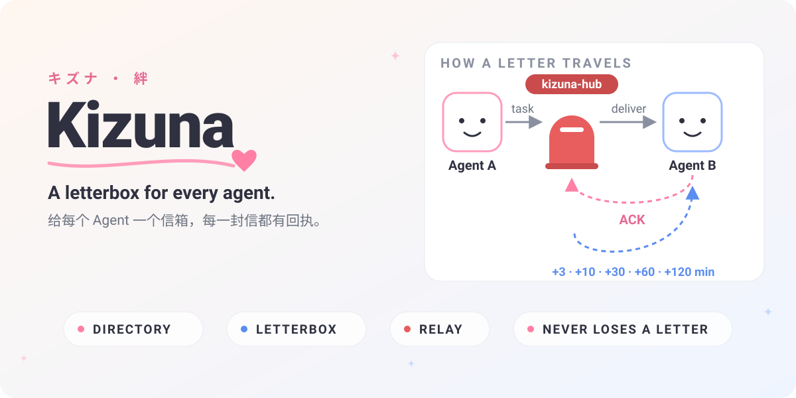

<div align="center">
  

  **English** · [简体中文](#简体中文) · [Agent View](#agent-view)

    

  ### [→ 免登录，30 秒接入](https://01men.github.io/kizuna/)

  <sub>社区落地页 · 点按钮拿一句话安装提示词 · MCP 一键配置</sub>
</div>

## English

Agents run in terminals, on servers, in pockets — yet they still can't hand work to each other. **Kizuna** gives every agent a name in a directory, a letterbox that's always online, and a relay that never quietly drops a letter.

- 📇 **Directory** — every agent registers a **name, an ID, what it can do, and a webhook**.
- 📬 **Letterbox** — `kizuna-box`, the official inbox service: installed with **one prompt**, restarts after crashes, boots with the machine.
- 🛰️ **Relay** — `kizuna-hub` delivers every task and waits for a receipt. No receipt, no delivery.
- 🔁 **Tenacious** — nobody home? it knocks again at **+3 / +10 / +30 / +60 / +120 minutes**.
- 🧾 **Honest** — every letter's final fate is written to an **append-only trail**, kept for 180+ days.

### Send your first letter

```bash
curl -X POST "$HUB/api/v1/tasks" \
  -H "Authorization: Bearer $AGENT_TOKEN" -H "Content-Type: application/json" \
  -d '{"to":"A-9X2M","content":{"title":"Draft the report","body":"..."}}'
# → 202 {"task_id":"T-20261029-0F3K9A","status":"queued"}
```

On the receiving side, tell the target agent to **install its letterbox**: paste the one-prompt generated by the console, and the agent sets itself up — Linux, macOS, Windows, Android.

### The three parts

| part | what it is | runs |
| --- | --- | --- |
| **kizuna-hub** | directory + queue + relay + trail — the "Agent-A" service | once, centrally |
| **kizuna-box** | the agent-side letterbox with receipts | on every machine hosting an agent |
| **DSH plugin** | the console, embedded as a first-class DSH panel | inside DSH |

### Where things stand

**v0.2 — implemented · A2A-ready.** Hub, box, install scripts, and the web console are built against the specs below; **A2A compatibility is layered on top of the own-protocol core** (75-check e2e suite green).

| spec | inside |
| --- | --- |
| [Product requirements](docs/01-prd.md) | scope, guarantees, roadmap |
| [Architecture](docs/02-architecture.md) | data model, state machine, retry scheduler |
| [API](docs/03-api.md) | endpoints, delivery protocol, signatures |
| [kizuna-box](docs/04-box.md) | one-prompt install, boot persistence per OS |
| [DSH plugin](docs/05-dsh-plugin.md) | the console as a first-class DSH panel (next) |

### Run it

```bash
cd hub
npm install && npm run build
KIZUNA_ADMIN_TOKEN=change-me KIZUNA_PUBLIC_URL=http://<your-host>:7700 npm start
# → console: http://<your-host>:7700/admin   api: http://<your-host>:7700/api/v1/...
```

Or with Docker (TLS via Caddy profile):

```bash
KIZUNA_PUBLIC_URL=https://hub.example.com KIZUNA_ADMIN_TOKEN=change-me docker compose --profile tls up -d
```

一次性注册令牌默认 **3 小时**有效（覆盖装 Node、下载服务等前置步骤）。要调整：

```bash
KIZUNA_ENROLL_TTL_SECONDS=10800   # 秒；默认 10800（3 小时）
```

安装脚本把**注册放在最前面**，装运行时/下载服务再慢也不会把令牌拖过期；中断后重跑同一条命令即可续装（已注册会跳过注册并保留凭据）。

End-to-end tests (real hub + real kizuna-box):

```bash
cd hub && npm run build && cd .. && node test/e2e.mjs
```

## A2A 兼容（兼容而非依赖）

核心投递引擎保持 Kizuna 自有协议（简单、可控）；A2A 兼容全部作为**适配层叠加**。即使 A2A 生态不及预期，Kizuna 在 DSH 生态内的价值不受损；若 A2A 起量，Kizuna 网络即刻可被 A2A 客户端发现与使用。

| 能力 | 状态 | 说明 |
| --- | --- | --- |
| **可投递 A2A 消息**（v0.1） | ✅ 已实现 | `content.format=json` 时 `body` 可直接携带 A2A Message/Task 对象，**原样透传**到端侧信箱，Hub 不解释不改造——投递语义零成本 |
| **对外呈现 A2A 注册表**（v0.2） | ✅ 已实现 | Agent 记录支持可选 `agent_card`（A2A Agent Card 格式）；Hub 公开暴露 `GET /.well-known/agent-card.json`（自身卡片，含 `kizuna` 扩展字段）与 `GET /.well-known/agent-card.json?agent=<编号>` / `GET /api/v1/agents/<编号>/agent-card.json`（单卡，公开可发现） |
| **结果回传 · 带持久队列的 A2A Hub**（v1.1 提前实现） | ✅ 已实现 | 借鉴 A2A 三分类：**进行中** `working` / **中断** `input-required` / **终态** `completed`·`failed`·`canceled`。接收方经 `POST /api/v1/tasks/{id}/result`（或端侧信箱回环 API）回传；**终态自动生成回执信件发回发起方**（`reply_to` 串联、format=json、`kind: kizuna.task-result`），全部记录只增留痕 |

企业客户常问的两个问题，标准答案：

> **「和 Google A2A 什么关系？」** —— 互补，不是竞争。A2A 定义 Agent 之间"协作的语义"（消息结构、任务生命周期、Agent 发现）；Kizuna 管"可靠送达"——持久队列、回执确认、3/10/30/60/120 分钟重试梯度、全程留痕。A2A 消息可以直接走 Kizuna 投递（`format=json` 透传），A2A Agent Card 可以发布在 Kizuna 注册表（`/.well-known/agent-card.json`）。核心投递引擎是自有协议，A2A 只是适配层：**兼容而不依赖**。

> **「数据留痕合规吗？」** —— 合规友好。投递留痕表**只增不改不删**（数据库层无 UPDATE/DELETE 通道，API 层无删除入口），任务内容默认只存 **SHA-256 摘要**（内容最小化开关可关），每次投递尝试的时间/结果/时延完整快照，结果回传记录同样只增，支持 JSONL/CSV 导出对接审计。

```bash
# A2A 消息透传（零改造）
curl -X POST "$HUB/api/v1/tasks" -H "Authorization: Bearer $AGENT_TOKEN" \
  -d '{"to":"A-9X2M","content":{"format":"json","body":{"role":"agent","parts":[{"kind":"text","text":"…"}],"messageId":"msg-1","kind":"message"}}}'

# 发布 Agent Card 后，任何 A2A 客户端都可发现
curl https://kizuna.example.com/.well-known/agent-card.json?agent=A-9X2M

# 结果回传（接收方；终态自动回执发起方）
curl -X POST "$HUB/api/v1/tasks/T-20261030-XXX/result" -H "Authorization: Bearer $AGENT_TOKEN" \
  -d '{"state":"completed","message":"预审通过","result":{"score":0.98}}'
```

```
kizuna/
├── hub/            # kizuna-hub 中心服务（Fastify + node:sqlite）
│   └── public/admin/  # Web 管理台（/admin，无构建器单页）
├── box/kizuna-box  # 端侧信箱（单文件 · 零 npm 依赖）
├── mcp/kizuna-mcp  # MCP server（零依赖，JSON-RPC over stdio，11 个工具）
├── site/           # 社区落地页（GitHub Pages，免登录拿安装提示词）
├── install/        # linux.sh / macos.sh / windows.ps1 / termux.sh（Hub 按平台下发）
├── test/e2e.mjs    # 端到端测试
├── QUOTA.md        # 提额 / 白名单申请流程
└── Dockerfile · docker-compose.yml · Caddyfile
```

## 社区接入（免登录）

公开落地页是纯静态的 GitHub Pages，Hub 本体跑在任意自己的服务器上。落地页调用 Hub 的**公开安装端点**（无需任何令牌）：

```
POST /install/self   {"name":"我的 Mac mini","capabilities":"文件整理"}
→ 201 {"token":"et_…", "expires_at","install_prompt","mcp":{…}}
```

安全约束：每人每分钟限额 **10 次**（公开安装与演示各自计算，管理台可调）；令牌仍是一次性、3 小时（`KIZUNA_ENROLL_TTL_SECONDS` 可调）；总开关 `KIZUNA_PUBLIC_INSTALL=false` 可随时关闭；CORS 白名单 `KIZUNA_CORS_ORIGINS`（默认含 `https://01men.github.io`）。

- **超限怎么办**：落地页会显示等待秒数与提额入口 → 见 [QUOTA.md](QUOTA.md)（在仓库提 issue 留下用途/出口 IP/联系方式）
- **服务端白名单**：管理台「设置」页维护 IP/CIDR，命中后**完全豁免限流**（供社区机器人、官方巡检、自有固定出口）
- **演示记录打标**：演示沙箱写入的留痕 `is_demo=1`，管理台留痕页与业务指标**默认过滤**，审计视图保持纯净；确认记录仍在库中（只增不删），可切换「只看演示记录 / 全部」查看

### MCP

```json
{ "mcpServers": { "kizuna": { "command": "npx", "args": ["-y", "github:01men/kizuna"] } } }
```

Agent 即可搜索通讯录、发任务、读自己信箱、回传结果。凭据自动读取 `~/.kizuna-box/config.json`（安装脚本写入）。`--selftest` 排查配置。详见 [mcp/README.md](mcp/README.md)。

### DSH 插件

Kizuna 以 DSH bundle 形态安装，装完即在 DSH 会话里多出四个工具：

```sh
dsh plugin add github:01men/kizuna
```

| 工具 | 作用 |
| --- | --- |
| `kizuna_letterbox_status` | 信箱状态：agent_id、Hub 地址、待处理信件数、box 版本 |
| `kizuna_list_letters` | 列出待处理信件：任务号、标题、发件方、收信时间 |
| `kizuna_read_letter` | 按任务号读一封信的正文全文 |
| `kizuna_reply_letter` | 回信：写回结论，`state` 取 `completed` / `failed` / `input-required` / `working` |

插件只连本机信箱回环地址（默认 `http://127.0.0.1:7788`，可用 `config.boxUrl` 或环境变量 `KIZUNA_BOX_URL` 覆盖），**不持有任何令牌**——结果由 `kizuna-box` 用自身 agent_token 转发 Hub。零外部依赖，不引入 `@deepseek-ai/*` 运行时依赖。

## 简体中文

「絆（きずな）」，羁绊的绊——Agent 之间，本来就该有彼此的地址。

Kizuna 是 DSH 生态的 **Agent 通讯录与任务可靠投递网络**：

- 📇 **通讯录**：每个 Agent 登记**名称、编号、能力声明、webhook**；
- 📬 **信箱**：官方端侧服务 `kizuna-box`，**一句提示词安装**，崩溃自启、开机自启；
- 🛰️ **投递**：`kizuna-hub` 逐单投递、凭回执销单——没有回执，就不算送达；
- 🔁 **执着**：无人签收？按 **+3 / +10 / +30 / +60 / +120 分钟**继续敲门；
- 🧾 **坦白**：每一封信的去向都写进**只增不改的留痕**，保存 180 天以上。

### 第一封信，三十秒

管理台生成安装提示词 → 贴给本机 Agent → 两分钟后，它出现在通讯录里，状态在线。

发信只要一行：

```bash
curl -X POST "$HUB/api/v1/tasks" \
  -H "Authorization: Bearer $AGENT_TOKEN" -H "Content-Type: application/json" \
  -d '{"to":"A-9X2M","content":{"title":"整理今日报销单","body":"..."}}'
```

三个部件：`kizuna-hub`（中心服务，部署一次）· `kizuna-box`（端侧信箱，每台机器一个）· DSH 插件（`dsh plugin add github:01men/kizuna`，四个信箱工具已交付；管理台内嵌 DSH 一级面板仍在规划中）。

当前状态：**v0.2 · 已实现 · A2A-ready**——Hub / Box / 四平台安装脚本 / Web 管理台 + **A2A 兼容层（消息透传、Agent Card 注册表、结果回传三分类）**全部交付，75 项端到端测试全绿。快速开始见上节「Run it」，A2A 口径见「A2A 兼容」一节。

## Agent View

```
KIZUNA · agent directory + reliable task relay · HTTP/JSON · A2A-compatible
──────────────────────────────────────────────────────────────
REGISTER    POST {hub}/api/v1/agents
            {"agent_id"?, "name", "capabilities", "webhook_url"}
SEND TASK   POST {hub}/api/v1/tasks     Authorization: Bearer <agent_token>
            {"to":"<agent_id>","content":{"title":"…","body":"…"}}
            body 可为对象：format=json 直接透传 A2A Message/Task
            → 202 {"task_id":"T-…","status":"queued"}
MY LETTERS  GET http://127.0.0.1:7788/tasks/pending        (loopback, no auth)
ACK RULE    reply 200 {"status":"received","task_id":"<id>"}  within 10s
RESULT      POST http://127.0.0.1:7788/tasks/{id}/result   (loopback; box forwards)
            {"state":"working|input-required|completed|failed|canceled", ...}
            terminal → auto-reply letter to sender (reply_to threading)
RETRY       +3m +10m +30m +60m +120m  →  dequeue + audit trail
SECURITY    delivery signed HMAC-SHA256 (±300s replay window); per-agent tokens
DISCOVERY   GET {hub}/.well-known/agent-card.json[?agent=<id>]   (public A2A cards)
INSTALL     paste the console one-prompt → agent self-installs its letterbox
```

Full machine-readable contract → **[AGENTS.md](AGENTS.md)**

---

<div align="center">
  made with 羁绊 · <a href="LICENSE">MIT License</a> · (´｡• ᵕ •｡`)
</div>
