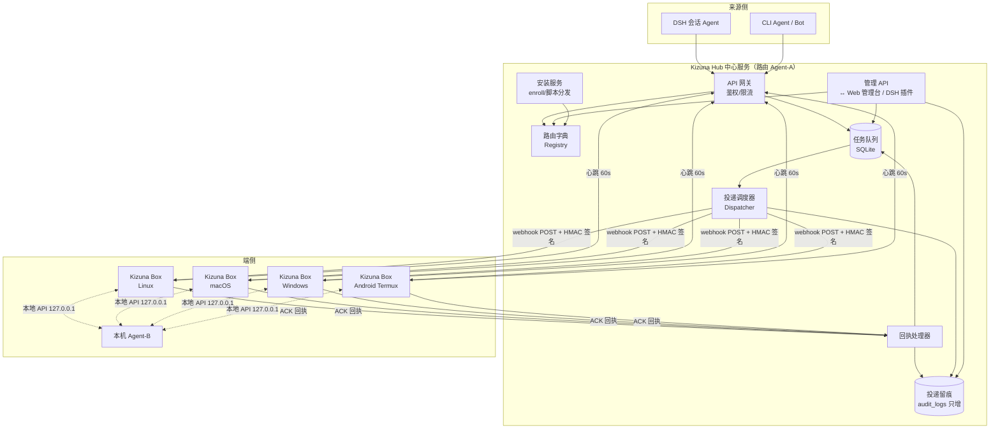
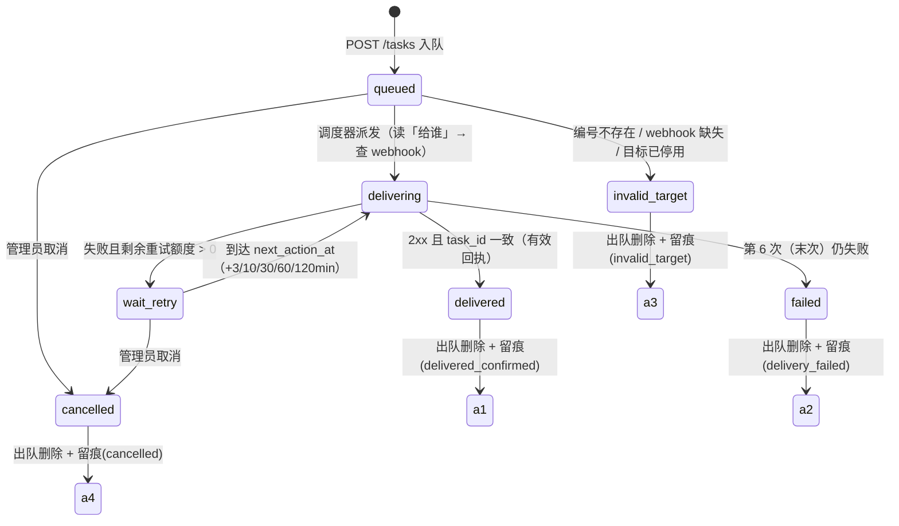
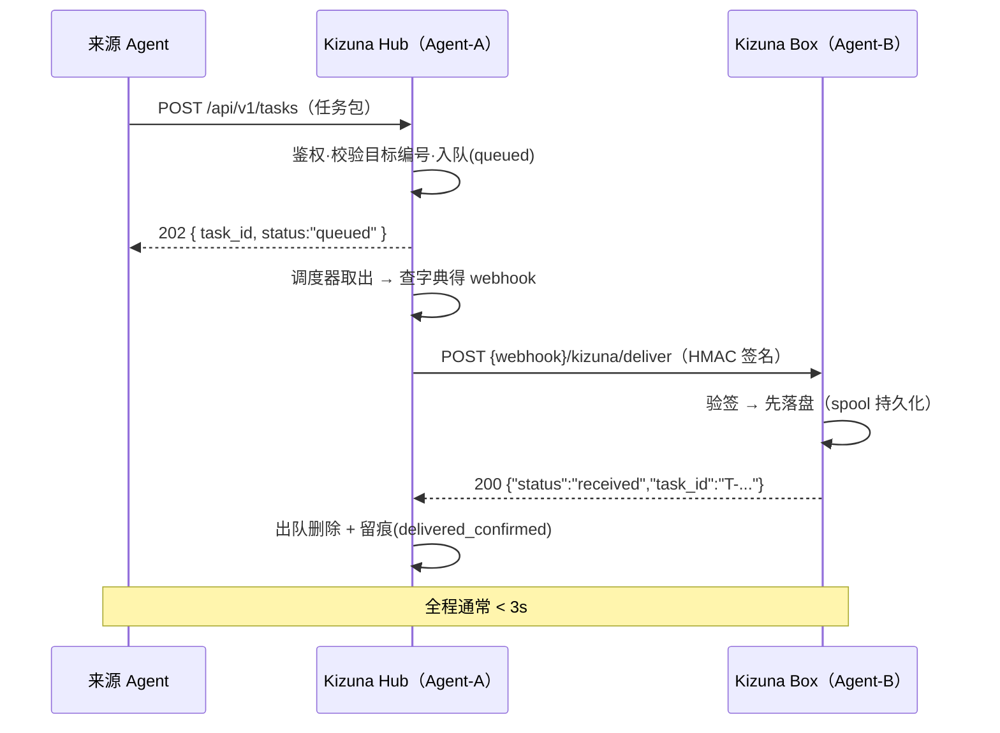
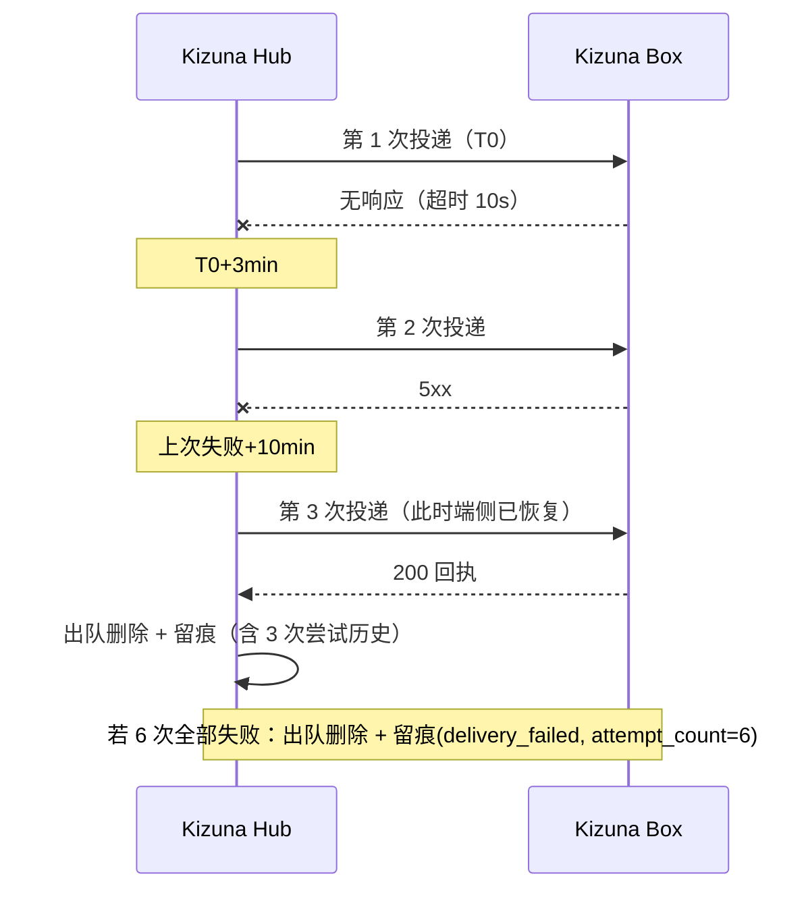

# 02 · 技术架构设计

> 产品：Kizuna · Agent 通讯录· 版本 v0.1 · 2026-10-29
> 上游文档：01-PRD · 下游：03-API规范 / 04-端侧Agent服务设计 / 05-DSH插件与管理界面设计

## 1. 总体架构



## 2. 模块职责

| 模块 | 职责 |
| --- | --- |
| API 网关 | 三级鉴权（管理员令牌 / Agent 令牌 / 一次性 enroll 令牌）、限流、错误规范 |
| 路由字典 | Agent 四要素 CRUD、编号唯一性、能力检索、上下线状态（心跳驱动） |
| 任务队列 | 任务包受理、持久化（SQLite WAL）、状态流转、出队删除 |
| 投递调度器 | 1s tick 扫描到期任务 → 读「给谁」→ 查字典 → 按 webhook 投递（并发 32，带抖动） |
| 回执处理器 | 校验回执（2xx + task_id 一致）→ 出队 + 留痕；失败 → 安排下一次重试 |
| 留痕服务 | 唯一写入口（只增不改不删 API），出队时落终态快照 |
| 安装服务 | 签发一次性 enroll 令牌、生成安装提示词、按平台分发安装脚本 |
| 管理 API | 供 Web 管理台与 DSH 插件（Host 半边代理）统一调用 |

## 3. 数据模型（SQLite，WAL 模式）

```sql
-- 路由字典
CREATE TABLE agents (
  agent_id        TEXT PRIMARY KEY,          -- 编号：A-XXXX（自动）或自定义唯一串
  name            TEXT NOT NULL,             -- 名称
  capabilities    TEXT NOT NULL DEFAULT '',  -- 能力声明（自由文本）
  capability_tags TEXT NOT NULL DEFAULT '[]',-- 能力标签（JSON 数组，可检索）
  webhook_url     TEXT NOT NULL,             -- 投递地址（http/https）
  endpoint_secret TEXT NOT NULL,             -- HMAC 签名密钥（投递用）
  agent_token     TEXT NOT NULL UNIQUE,      -- 该 Agent 调 Hub API 的令牌
  enabled         INTEGER NOT NULL DEFAULT 1,
  status          TEXT NOT NULL DEFAULT 'unknown',  -- online / offline / unknown
  last_seen_at    TEXT,
  created_at      TEXT NOT NULL,
  updated_at      TEXT NOT NULL
);

-- 任务队列（终态任务不留行，快照进 audit_logs）
CREATE TABLE tasks (
  task_id        TEXT PRIMARY KEY,           -- T-YYYYMMDD-XXXXXX
  from_agent     TEXT NOT NULL,
  to_agent       TEXT NOT NULL,
  title          TEXT,
  content        TEXT NOT NULL,              -- 任务内容主体
  format         TEXT NOT NULL DEFAULT 'text',   -- text | markdown | json
  priority       TEXT NOT NULL DEFAULT 'normal', -- normal | high
  deadline       TEXT,
  status         TEXT NOT NULL DEFAULT 'queued', -- queued/delivering/wait_retry
  attempt_count  INTEGER NOT NULL DEFAULT 0,
  next_action_at TEXT,                        -- 下次投递/重试时刻（UTC ISO8601）
  created_at     TEXT NOT NULL
);
CREATE INDEX idx_tasks_next ON tasks(next_action_at);
CREATE INDEX idx_tasks_status ON tasks(status);

-- 逐次尝试明细（在途期间可查；出队时整体快照进留痕）
CREATE TABLE task_attempts (
  id           INTEGER PRIMARY KEY AUTOINCREMENT,
  task_id      TEXT NOT NULL,
  n            INTEGER NOT NULL,             -- 第几次尝试（1 起）
  attempted_at TEXT NOT NULL,
  outcome      TEXT NOT NULL,                -- ack / timeout / network_error / http_4xx / http_5xx / bad_ack / invalid_signature
  http_status  INTEGER,
  latency_ms   INTEGER,
  detail       TEXT
);

-- 投递留痕：只增不改不删（无 UPDATE/DELETE 通道）
CREATE TABLE audit_logs (
  id             INTEGER PRIMARY KEY AUTOINCREMENT,
  log_id         TEXT UNIQUE NOT NULL,       -- AL-YYYYMMDD-XXXXXX
  task_id        TEXT NOT NULL,
  from_agent     TEXT NOT NULL,
  to_agent       TEXT NOT NULL,
  enqueued_at    TEXT NOT NULL,
  dequeued_at    TEXT NOT NULL,
  outcome        TEXT NOT NULL,              -- delivered_confirmed / delivery_failed / invalid_target / cancelled
  attempt_count  INTEGER NOT NULL,
  attempts_json  TEXT NOT NULL,              -- 全部尝试历史快照（JSON）
  content_digest TEXT,                       -- 任务内容 SHA-256 摘要（最小化选项）
  note           TEXT
);
CREATE INDEX idx_audit_outcome ON audit_logs(outcome, dequeued_at);

-- 一次性注册令牌（安装提示词携带，10 分钟有效、用后作废）
CREATE TABLE enroll_tokens (
  token      TEXT PRIMARY KEY,
  agent_draft TEXT NOT NULL,                 -- 预填的编号/名称/能力声明
  created_at TEXT NOT NULL,
  expires_at TEXT NOT NULL,
  used_at    TEXT
);
```

## 4. 任务包状态机



> 终态任务从 `tasks` 删除（队列保持干净），完整快照写入 `audit_logs`。设计决策：`invalid_target` 不进重试——目标不存在时重试注定无意义，直接出队留痕，让失败尽早暴露（相对立项陈述的补充规则，已列入 PRD 追溯表）。

## 5. 核心时序

### 5.1 正常签收（Happy Path）



### 5.2 失败重投（Retry Ladder）



## 6. 投递调度器设计

- **扫描循环**：每 1s `SELECT ... WHERE status IN ('queued','wait_retry') AND next_action_at <= now() LIMIT 64`，取到期任务投递；SQLite 单写者足够。
- **重试梯度**（间隔自上次尝试失败起算，可配置，默认值即立项要求）：

| 尝试次序 | 时刻 | 说明 |
| --- | --- | --- |
| 第 1 次 | T0 | 首投 |
| 第 2 次 | T0 + 3min | 重试 1 |
| 第 3 次 | 上次失败 + 10min | 重试 2 |
| 第 4 次 | 上次失败 + 30min | 重试 3 |
| 第 5 次 | 上次失败 + 60min | 重试 4 |
| 第 6 次 | 上次失败 + 120min | 末次；失败即出队 + 留痕 |

  累计总跨度约 **3 小时 43 分钟**。
- **投递判定**（详见 03 §3）：HTTP 连接超时 5s、整体超时 10s；2xx 且响应体 `task_id` 一致 → `ack`；2xx 但 task_id 不一致 → `bad_ack`（按失败处理）；其余按 `http_4xx/http_5xx/timeout/network_error` 记录。
- **并发与抖动**：全局并发 32；对同一目标的投递串行（避免端侧乱序）；每次重试附加 ±5s 随机抖动，防止重投风暴。
- **崩溃恢复**：启动时把所有 `delivering` 复位为 `queued`（next_action_at=now），利用幂等的 task_id 保证端侧不产生重复信件（见 §7）。

## 7. 幂等与一致性

| 环节 | 机制 |
| --- | --- |
| 端侧防重 | 以 `task_id` 为主键落盘；重复投递（重试窗口内重发成功）直接幂等返回同一回执，不产生第二条信件 |
| 落盘先行 | 端侧**先持久化、再回 200**；Hub 视角「收到回执 ⇒ 端侧必已落盘」 |
| Hub 出队 | 收到有效回执后：写尝试明细 → 写留痕 → 删 `tasks` 行，同一事务完成 |
| 投递至多一次 vs 至少一次 | 本方案为「至少一次投递 + 端侧幂等去重」，语义上等效「恰好一次信件落箱」 |

## 8. 安全设计

- **三级令牌**：
  - 管理员令牌（Admin Token）：管理 API 全量权限，Web 管理台/DSH 插件 Host 半边持有；
  - Agent 令牌（Agent Token）：该 Agent 提交任务包、心跳、查询自己的任务；
  - 一次性注册令牌（Enroll Token）：安装提示词携带，10 分钟有效、用后作废，换取正式 Agent Token。
- **投递签名**：Hub → 端侧带 `X-Kizuna-Timestamp` 与 `X-Kizuna-Signature: sha256=HMAC(endpoint_secret, timestamp + '.' + rawBody)`；端侧校验时间窗 ±300s 防重放（算法与示例代码见 03 §6）。
- **端侧端口分离**：交付端口（收 Hub 投递，必须验签）与本地 API（127.0.0.1 回环，供本机 Agent 读取）分端口监听。
- **传输**：生产环境 Hub 与 webhook 全链路 HTTPS；Hub 强制管理员登录（令牌）。
- **最小化**：留痕默认只存任务内容摘要；管理界面展示任务正文需权限（v1.0 ACL）。

## 9. 技术选型

| 项 | 选择 | 理由 |
| --- | --- | --- |
| 语言/运行时 | Node.js 20 + TypeScript | 与团队现有 DSH 插件/解析器栈一致；端侧可零依赖单文件运行 |
| Hub 框架 | Fastify | 轻量、schema 校验、性能足够 |
| 存储 | SQLite（better-sqlite3，WAL） | 单文件运维最简，单机写吞吐远超需求；HA 演进路径 Postgres（v1.1+） |
| 端侧服务 | 单文件 Node 脚本（仅用 `node:http`/`node:fs`，零 npm 依赖） | 五平台安装脚本最简化；crash 自启交给系统服务管理器 |
| 部署 | 裸机 systemd / Docker Compose（hub + 卷 + Caddy TLS） | 二选一，运维成本最低 |

## 10. 部署与运维

- **Hub 单机部署**：`kizuna-hub` 进程（默认端口 7700）+ `data/kizuna.db`；Docker Compose 样例随仓库提供；Caddy 反代终止 TLS。
- **备份**：每日 `sqlite3 .backup` 快照（含留痕），保留 30 份；留痕另按月导出 JSONL 归档。
- **监控指标**（`GET /metrics`，Prometheus 文本格式，v1.0）：
  - `kizuna_queue_depth`（队列深度；> 1000 告警）
  - `kizuna_deliveries_total{outcome}`（投递结果计数）
  - `kizuna_delivery_latency_seconds`（投递→回执时延直方图）
  - `kizuna_agents_online`（在线 Agent 数）
  - `kizuna_audit_deletions_total{outcome}`（出队留痕计数）
- **日志**：结构化 JSON 日志，按 10MB × 5 轮转；投递与出队留痕事件单独打点。
