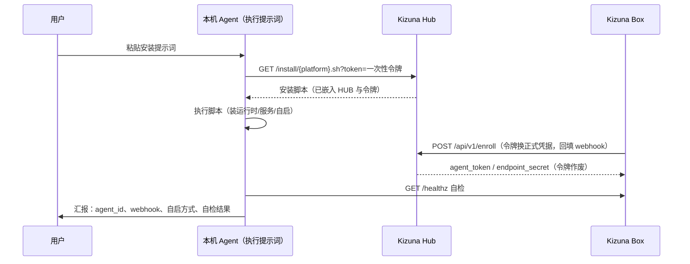

# 04 · 端侧 Agent-B 服务（Kizuna Box）设计

> 产品：Kizuna · Agent 通讯录· 版本 v0.1 · 2026-10-29
> 依赖：02-技术架构 / 03-API规范 §3（投递协议）§5（安装服务）

## 1. 定位与形态

Kizuna Box 是**本产品官方提供的端侧常驻服务**——Agent-B 的「信箱」。用户不需要自己写 webhook 脚本。

- **形态**：单文件 Node.js 服务（仅用 `node:http` / `node:fs` / `node:crypto`，**零 npm 依赖**），一个二进制式脚本 + 一份配置；
- **职责**：接收 Hub 投递 → 验签 → **先落盘后回执** → 供本机 Agent 通过回环 API 读取 → 心跳上报；
- **端口**：默认 `7788`（交付路径 `/kizuna/deliver` 强制验签；回环路径供本机 Agent 使用，见 03 §4）。

```
~/.kizuna-box/
├── bin/kizuna-box          # 服务主程序（单文件 JS）
├── config.json               # hub_url / agent_id / tokens / listen 端口
├── spool/                    # 信箱：已签收的任务包（task_id.json，处理完可归档）
├── state/enroll.lock         # 注册状态
└── logs/                     # 运行日志（10MB × 5 轮转）
```

## 2. 运行时保障（稳定性与开机自启的总原则）

| 目标 | 手段 |
| --- | --- |
| 进程崩溃自启 | 交给系统服务管理器：systemd `Restart=always` / launchd `KeepAlive` / Windows 服务 `onfailure restart` / Termux `sv` |
| 开机自启 | systemd `multi-user.target` / launchd `RunAtLoad` / Windows 服务自启 / Termux:Boot |
| 任务不丢 | 端侧**先写 spool（原子写 + fsync）、再回 200**；Hub 视角「有回执必有信件」（02 §7） |
| 断网自愈 | 心跳失败指数退避重连（60s→300s 封顶），网络恢复自动续上 |
| 资源占用 | 目标：空闲 RSS < 50MB、CPU < 1%；单文件无依赖，内存常驻极小 |
| 可观测 | `GET /healthz` + 结构化日志轮转 |

## 3. 一句提示词安装部署

产品主张：**用户唯一要做的事，是把下面这段提示词贴给目标机器上的 Agent**（DSH、任意 CLI Agent 均可）。提示词由管理台「安装部署」页自动生成（Hub 一次性 enroll 令牌已填充），文案全文如下：

```text
请把本机接入 Kizuna · Agent 通讯录，安装并部署端侧服务 Kizuna Box。严格按步骤执行：
1. 探测当前系统（Linux / macOS / Windows / Android-Termux / 其他）。「其他」一律终止并说明原因。
2. 用对应平台的一键脚本安装（HUB={{HUB_URL}}，ENROLL_TOKEN={{ENROLL_TOKEN}}，令牌一次性、10分钟内有效，请立即执行）：
   - Linux:   curl -fsSL "{{HUB_URL}}/install/linux.sh?token={{ENROLL_TOKEN}}" | bash
   - macOS:   curl -fsSL "{{HUB_URL}}/install/macos.sh?token={{ENROLL_TOKEN}}" | bash
   - Windows: powershell -c "irm '{{HUB_URL}}/install/windows.ps1?token={{ENROLL_TOKEN}}' | iex"
   - Termux:  curl -fsSL "{{HUB_URL}}/install/termux.sh?token={{ENROLL_TOKEN}}" | bash
   脚本会自动：安装运行时（如缺失）→ 下载服务 → 用令牌完成注册（换取正式凭据、回填 webhook）→
   配置开机自启 → 启动服务。
3. 自检：请求 http://127.0.0.1:7788/healthz，确认 ok=true 且 agent_id 非空；
   再确认本机 Agent 可用 GET /tasks/pending 读到信箱。
4. 汇报：系统类型、agent_id、webhook 地址、自启方式（服务名/单元名）、自检结果。
   任何一步失败：给出失败原因、已执行的命令与修复建议，不要静默重试超过 3 次。
```

**执行链路**：



安全要点：enroll 令牌一次性、10 分钟过期；换取的正式凭据只写入端侧 `config.json`（权限 600），不回显给 Agent 汇报内容。

## 4. 平台安装脚本与开机自启配置

| 平台 | 运行时获取 | 服务托管（自启+自拉起） |
| --- | --- | --- |
| Linux | apt/dnf 装 Node 20（缺失时） | systemd |
| macOS | 官方 pkg / Homebrew（缺失时） | launchd（LaunchAgent） |
| Windows | winget 装 Node 20（缺失时） | WinSW 托管的 Windows 服务 |
| Android | Termux `pkg install nodejs` + `termux-services` | runit（`sv`）+ Termux:Boot |
| 鸿蒙 | **v1 不提供脚本**（限制见 PRD §8），替代路径见 §4.5 |

### 4.1 Linux（systemd）

```bash
curl -fsSL "https://<hub>:7700/install/linux.sh?token=<ENROLL_TOKEN>" | bash
```

脚本落点 `/opt/kizuna-box/`，并写入 `/etc/systemd/system/kizuna-box.service`：

```ini
[Unit]
Description=Kizuna Endpoint (Kizuna端侧服务)
After=network-online.target
Wants=network-online.target

[Service]
Type=simple
ExecStart=/opt/kizuna-box/bin/node /opt/kizuna-box/bin/kizuna-box run --config /etc/kizuna-box/config.json
Restart=always
RestartSec=5
User=kizuna
Environment=NODE_ENV=production

[Install]
WantedBy=multi-user.target
```

`systemctl daemon-reload && systemctl enable --now kizuna-box` → 崩溃 5s 拉起、开机自启。

### 4.2 macOS（launchd）

脚本写入 `~/Library/LaunchAgents/app.kizuna.kizuna-box.plist`（路径由脚本按当前用户绝对路径填充）：

```xml
<?xml version="1.0" encoding="UTF-8"?>
<!DOCTYPE plist PUBLIC "-//Apple//DTD PLIST 1.0//EN" "http://www.apple.com/DTDs/PropertyList-1.0.dtd">
<plist version="1.0">
<dict>
  <key>Label</key><string>app.kizuna.kizuna-box</string>
  <key>ProgramArguments</key>
  <array>
    <string>/usr/local/opt/node/bin/node</string>
    <string>/Users/<user>/.kizuna-box/bin/kizuna-box</string>
    <string>run</string>
    <string>--config</string>
    <string>/Users/<user>/.kizuna-box/config.json</string>
  </array>
  <key>RunAtLoad</key><true/>
  <key>KeepAlive</key><true/>
  <key>ThrottleInterval</key><integer>5</integer>
  <key>StandardOutPath</key><string>/Users/<user>/.kizuna-box/logs/out.log</string>
  <key>StandardErrorPath</key><string>/Users/<user>/.kizuna-box/logs/err.log</string>
</dict>
</plist>
```

`launchctl bootstrap gui/$UID ~/Library/LaunchAgents/app.kizuna.kizuna-box.plist` → 登录即启、退出即拉。

### 4.3 Windows（WinSW 托管服务）

脚本流程：`winget install OpenJS.NodeJS.LTS`（缺失时）→ 落点 `C:\Program Files\Kizuna Box\` → 下载 WinSW-x64.exe 改名 `kizuna-box-service.exe` + 同名 XML：

```xml
<service>
  <id>kizuna-box</id>
  <name>Kizuna Endpoint</name>
  <description>Kizuna端侧接收服务</description>
  <executable>"C:\Program Files\Kizuna Box\bin\node.exe"</executable>
  <arguments>"C:\Program Files\Kizuna Box\bin\kizuna-box" run --config "C:\ProgramData\Kizuna Box\config.json"</arguments>
  <startmode>Automatic</startmode>
  <onfailure action="restart" delay="5 sec"/>
  <log mode="roll-by-size"><sizeThreshold>10240</sizeThreshold><keepFiles>5</keepFiles></log>
</service>
```

`kizuna-box-service.exe install && kizuna-box-service.exe start` → 开机自动（服务身份，无需登录）、崩溃 5s 重启。备选（无管理员权限时）：计划任务「登录时启动 + 失败重启」。

### 4.4 Android（Termux）

```bash
pkg install -y nodejs termux-services
curl -fsSL "https://<hub>:7700/install/termux.sh?token=<ENROLL_TOKEN>" | bash
```

脚本写入 `$PREFIX/var/service/kizuna-box/run`：

```sh
#!/data/data/com.termux/files/usr/bin/sh
termux-wake-lock
exec "$HOME/.kizuna-box/bin/kizuna-box" run --config "$HOME/.kizuna-box/config.json" 2>&1
```

`sv-enable kizuna-box` → Termux 会话内由 `sv` 托管（崩溃即拉起）；配合 **Termux:Boot** 实现设备开机自启（termux-services 开机拉起全部已启用服务）。

### 4.5 鸿蒙（v1 边界与替代路径）

HarmonyOS NEXT 不开放第三方后台常驻脚本运行时，**v1 不提供鸿蒙安装脚本**。产品在「安装部署」页对鸿蒙用户明示三条替代路径：

1. **代理机模式**（推荐）：在设备可达的同网段机器/云主机上安装 Kizuna Box，webhook 指向该机；设备上的 Agent 通过回环语义等价的本地代理（如设备可访问该机的 `/tasks/pending`）取件；
2. **v2.0 ArkTS 原生 SDK**：应用内常驻接收（见 PRD §7 版本规划）；
3. **行业定制系统**：若设备具备开放终端环境，可按 Termux 方案尝试（不承诺）。

## 5. 稳定性设计细则

1. **落盘先行**：`/kizuna/deliver` 处理顺序 = 验签 → 原子写 `spool/<task_id>.json`（临时文件 + rename + fsync）→ 回 200。任何一步失败返回 5xx，由 Hub 重试梯度兜底。
2. **幂等去重**：spool 以 `task_id` 为主键，重复投递直接返回同一回执（03 §3 超时场景的安全网）。
3. **心跳**：60s 一次；失败退避 60→300s；恢复后立即补跳。
4. **日志轮转**：单文件 10MB × 5；交付、验签失败、enroll 事件单独打点。
5. **配置**：`config.json` 仅 600 权限；证书/密钥不落日志；升级即重跑安装脚本（同路径覆盖 bin、保留 spool 与 config）；`--uninstall` 提供干净卸载（默认保留 spool 数据）。
6. **自检脚本**：安装结束自动执行 healthz、自启单元状态、hub 连通性三项检查并在终端打印报告（提示词第 4 步要求 Agent 汇报该结果）。

## 6. 验收清单

- [ ] 全新 Linux / macOS / Windows 机器仅凭安装提示词完成部署，Hub 通讯录中出现该 Agent 且状态 `online`；
- [ ] `kill -9` 服务进程，5~10s 内被服务管理器拉起，`healthz` 恢复；
- [ ] 重启整机，服务随开机自动运行（无需登录的场景：Linux/Windows 服务方式）；
- [ ] 投递期间断网 30s 再恢复：Hub 侧表现为 1~2 次重试后签收，spool 无重复信件；
- [ ] 用错误签名请求 `/kizuna/deliver` 得到 401，且 Hub 收到 `invalid_signature` 并告警；
- [ ] 升级（重跑脚本）后 spool 与 config 保留，服务无感切换。
